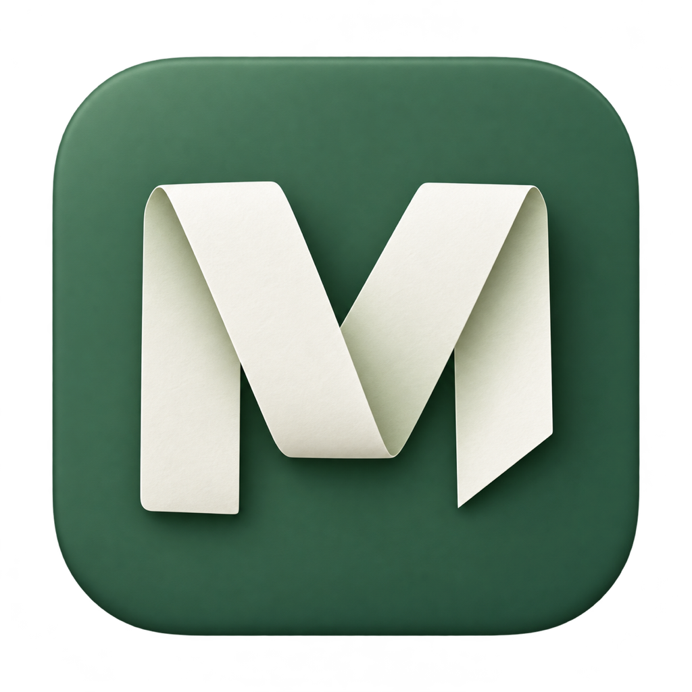

# Machete

A small desktop space for useful text. Save a command, a link, or a thought;
organize clips into boards; find and copy them when you need them again.

Built for macOS with Electron, React, TypeScript, Tailwind CSS, and shadcn/ui.

## Download

Installers are available from [GitHub Releases](https://github.com/tonirilix/machete/releases)
after a release build finishes. Choose `arm64.dmg` for Apple Silicon (M1 or later)
or `x64.dmg` for Intel, open the disk image, and drag Machete into Applications.
Quit an older copy before replacing it. ZIP downloads and SHA-256 checksums are
also provided.

The downloads are ad-hoc signed, not notarized by Apple. If macOS blocks the first
launch and you trust the download, follow
[Apple’s opening instructions](https://support.apple.com/en-us/102445).
Selection capture still requires Accessibility permission; a new ad-hoc build can
require permission again.

## Run

Use Node.js 22.12+ and npm.

```sh
npm install
npm run dev
```

The app opens a compact window and stays in the menu bar when the window closes.
On macOS it keeps a Dock icon as well as its menu bar icon.
Right-click the menu bar icon to quit. New collections start with an empty Inbox.

- **Cmd+Shift+Space:** capture selected text from another app on macOS; capture
  copied text on other platforms. Each capture saves a separate clip in Inbox,
  without opening an editor or changing your manual draft.
- **New clip / Resume draft** or **Cmd+N:** compose a manual draft. Use **Append
  clipboard** inside the editor to collect multiple pieces into that draft, then
  save them as one clip. Shortcut captures always save separate clips.
- **Enter:** insert a newline in the editor.
- **Cmd+Enter:** save a clip.
- **Cmd+K:** focus search while browsing.
- **Cmd/Shift+click:** select clips; **Cmd+C** copies them in visible order.
- **Escape:** dismiss the active dialog/editor or clear selection/search. Keeps the app visible.

Change the capture shortcut in Settings if it conflicts with another app.

On macOS, Settings → Capture shortcut also offers **Double Shift**. Tap and
release the same Shift key twice quickly. Both left and right Shift work. Held
keys, typing, other modifiers, clicking, or changing apps cancel the gesture.
Double Shift uses the same Accessibility permission as selection capture and
does not consume keystrokes. It observes key events only to recognize the gesture
and never records typed text.

### Enable selection capture on macOS

In Machete Settings, click **Enable selection capture**, then allow
**Machete** under **Privacy & Security → Accessibility** in System Settings.
Return to another app, select text, and press **Cmd+Shift+Space**. The selection
is saved immediately as a new clip in Inbox. If permission does not update,
quit and reopen Machete. Use the packaged app when granting permission;
development mode runs under Electron's identity.
Local macOS packages use an ad-hoc signature. Rebuilding changes the code identity
and can require granting Accessibility again. Quit every running Machete copy
before replacing the app, then grant access to the exact signed copy you launch.
A switch left enabled for an older build does not prove the new build has access.

The app reads selections only when you invoke the shortcut. It first asks the
source app for accessible selected text. When unavailable, it sends Copy and
restores the previous clipboard's formats, unless something newer was copied.
Unsupported selections produce a message; **Capture clipboard** remains a manual
alternative. There is no background clipboard monitoring.

## Data

The desktop app keeps `collection.json` in
`~/Library/Application Support/Cliptoboards/`. Clips, boards, Trash, the unfinished
draft, and shortcut settings are stored locally. Writes are serialized and use a
temporary file followed by a rename; failed writes do not replace the in-memory
collection. An unreadable collection is left intact and reported at startup.

Settings provides simple JSON export/import. Export includes boards, saved clips,
and Trash. Import validates the file and asks for confirmation before replacing
the collection; the local shortcut is preserved and the unfinished draft is
cleared. Drafts and device settings are not part of the portable backup.

Machete keeps the original `Cliptoboards` collection directory, backup format
identifier, and macOS bundle identifier for compatibility with existing data and
installations. The app and npm package are now named Machete and `machete`.

Set `MACHETE_DATA_DIR` to a separate directory when testing with disposable
desktop data.

## Browser preview

```sh
npm run dev:web
```

Open `http://localhost:5173`. The browser preview uses a separate collection in
browser storage and browser clipboard permissions. It shares the desktop UI and
domain logic. Native tray access, global shortcuts, and desktop focus behavior
require the Electron app.

## Check and package

```sh
npm run typecheck
npm test
npm run test:native
npm run test:desktop
npm run build
npm run pack
npm run dist:mac
npm run test:launch
npm run test:selection
```

`pack` creates an ad-hoc signed local macOS application in `release/`. This needs
no Apple account and does not notarize the app. A persistent Apple signing identity,
notarization, and automatic updates remain future distribution work.

On macOS, open the packaged app with `open release/mac/Machete.app`.
Running that command again brings the existing window forward.

The app uses the Folded M icon. Its 1024px master is `resources/icon.png`;
after replacing it, run `npm run build:icons` on macOS to regenerate the `.icns`,
header icon, and browser favicon. These generated assets are checked in so
release builds use them without running image conversion tools.

### Automated release builds

After this workflow is merged into `main`, open **Actions → Build macOS release →
Run workflow**, select a branch, and run it. This publishes a development
prerelease named `build-<run-id>` with a unique `-dev.<run-id>` app version. It
does not replace the latest stable release.

For a versioned release, commit a version bump in both `package.json` and
`package-lock.json` (for example, `npm version patch --no-git-tag-version`), then
push a matching tag such as `v0.1.1`. Tags must exactly match `v<package version>`.
Versions containing a prerelease suffix, such as `0.2.0-beta.1`, remain prereleases.

The workflow runs tests, compiles the native module separately on standard Intel
and Apple Silicon macOS runners, and creates a DMG and ZIP for each architecture.
It checks signatures and architectures, then uploads the installers and checksums
directly to a draft GitHub Release. Only after both builds pass is the release
published. Failed runs leave an unpublished draft; rerunning resumes that draft.
Published releases are never overwritten, and previous releases are retained.

No Actions artifacts or dependency caches are uploaded. The workflow only runs
for public repositories, where standard hosted runners are free. Downloads live
in GitHub Releases, which has separate storage from the Actions artifact allowance.
See [Actions billing](https://docs.github.com/en/billing/concepts/product-billing/github-actions)
and [release limits](https://docs.github.com/en/repositories/releasing-projects-on-github/about-releases).
Account billing budgets are managed separately in GitHub Settings; this workflow
does not change them. No Apple signing credentials are required for these ad-hoc
builds; Developer ID signing, notarization, and automatic app updates remain separate work.

The macOS launch check requires a desktop session, Xcode Command Line Tools, and
an existing packaged app. It checks five fresh launches without a debugger,
including launches with `ELECTRON_RUN_AS_NODE=1` from Electron-hosted terminals.
It verifies visible windows and a visible Dock role through macOS, then tests
reopening after hiding, closing, and minimizing. It uses temporary copies with
disposable data and leaves the clipboard untouched. A separate startup check
quits during the initial page load and verifies that shutdown finishes without
showing a startup error.

The desktop smoke test runs the actual Electron app with disposable data and
restores the system clipboard after checking the native bridge. Desktop launch
scripts handle terminals hosted inside other Electron apps, including T3.
The packaged app disables Electron's RunAsNode mode so those terminals cannot
accidentally launch it as a Node process instead of opening its window.

Building the macOS selection bridge requires Xcode Command Line Tools. Native
pasteboard tests use a separate named pasteboard and leave the system clipboard
untouched. The native binary is built for the current architecture and unpacked
beside the packaged app's resources.

The selection check requires Accessibility permission for the packaged app. It
briefly opens native test windows and checks immediate selection saving, draft preservation,
the Copy fallback, clipboard restoration, and explicit saving. It uses a
disposable collection, then reopens the app with your usual collection.

See [the MVP brief](docs/design.md), [domain vocabulary](GLOSSARY.md), and
[architecture decisions](docs/adr/).
